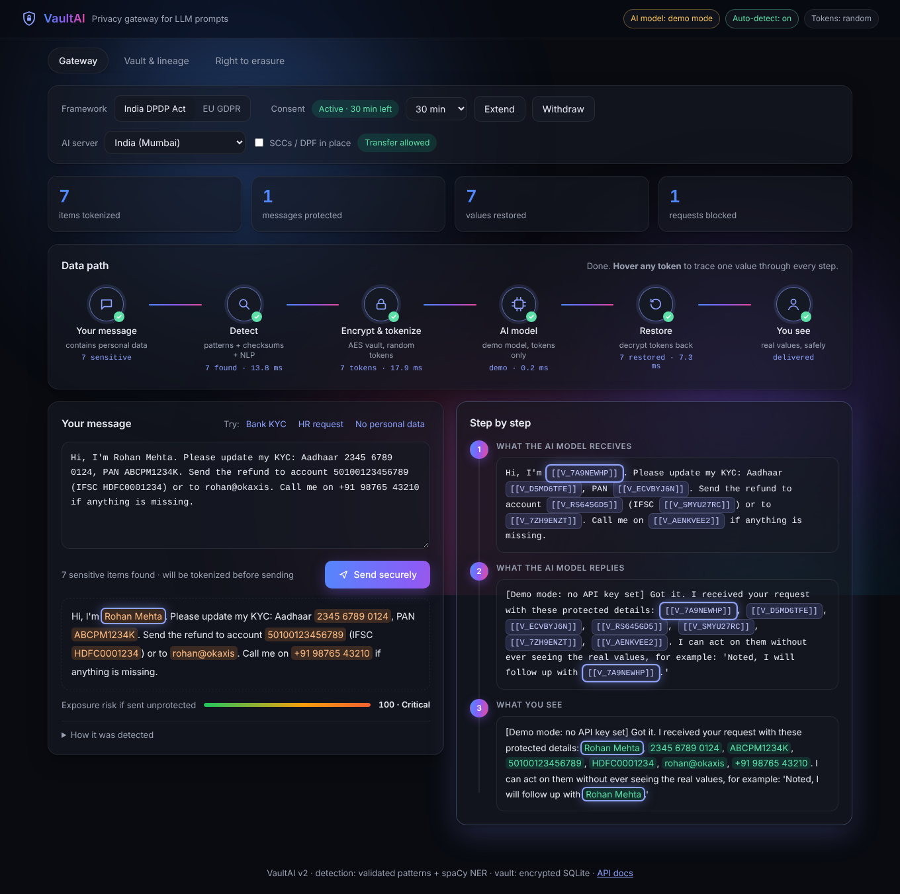

# VaultAI: a privacy gateway for LLM prompts

[](https://github.com/HarshJ05/vaultai/actions/workflows/tests.yml)

**Live demo:** https://vaultai-five.vercel.app (runs in demo mode without an API key; the hosted vault is temporary and resets on its own)

People paste Aadhaar numbers, phone numbers, bank details and names into AI chatbots. VaultAI sits between the user and the LLM: it **automatically finds personal data (no labelling needed), swaps each item for a random token, sends only the tokens to the model, and puts the real values back in the reply**. The model never sees the real data, or even what kind of data was removed.



```
"Call Priya Sharma on 98765 43210"
        │  1. detect PII (validated patterns + spaCy NER + Indian name list)
        ▼
"Call [[V_K7Q2MX9A]] on [[V_3RT8HZ4C]]"  ──►  LLM  ──►  "Sure, I'll call [[V_K7Q2MX9A]] at [[V_3RT8HZ4C]]."
        │  2. real values encrypted in the vault        │  3. tokens restored
        ▼                                               ▼
   SQLite vault (Fernet-encrypted + HMAC fingerprint)   "Sure, I'll call Priya Sharma at 98765 43210."
```

## Results

Measured on a **held-out** test set of 420 sentences (544 PII spans, 120 hard negatives such as order IDs, OTPs and claim numbers). These sentence patterns were written once and never used while building the detector. Strict scoring: the type *and* the exact span must match.

| Configuration | Precision | Recall | F1 | Hard negatives wrongly flagged |
|---|---|---|---|---|
| Regex only | 79.0% | 53.9% | 64.0% | 55% |
| + checksums (Verhoeff, Luhn, GSTIN) | 93.0% | 53.9% | 68.2% | 18% |
| + context words | 99.2% | 70.0% | 82.1% | 2% |
| **+ spaCy NER + Indian name list (full)** | **94.8%** | **98.2%** | **96.5%** | **2%** |

- Each layer earns its place: checksums cut false alarms from 55% to 18%, context words cut them to 2%, and NER lifts recall from 70% to 98%.
- Names the engine had never seen: 92% recall (73/79). Names in the built-in list: 100%.
- Full per-type tables: [`eval/holdout_results.md`](eval/holdout_results.md) and the development set [`eval/dataset_results.md`](eval/dataset_results.md).

**Known limitations (honest notes):**
- A random 12-digit number passes the Aadhaar checksum 1 time in 10, so a few claim and account numbers are still flagged when no negative word sits next to them.
- Street names like "MG Road" are flagged as locations. The test labels didn't mark them, so they count as errors, though in practice redacting them is the safe choice.
- The test data is synthetic. Real text is messier, so these numbers are for comparing versions, not a guarantee.

## What it detects (18 types)

| Category | Types | How |
|---|---|---|
| Government ID | Aadhaar, PAN, passport, voter ID | regex + **Verhoeff checksum** (Aadhaar), PAN holder-type check |
| Financial | card, bank account, IFSC, UPI ID | regex + **Luhn checksum** + card-network prefixes |
| Business | GSTIN | regex + **mod-36 checksum** |
| Contact / online | phone, email, IP address | regex + validity checks |
| Personal | date of birth, vehicle number, PIN code | regex + state codes + context words |
| Identity / location | person, location, organisation | **spaCy `en_core_web_md`** + Indian name list + city list |

Every match gets a confidence score. It starts at a base value per type, goes **up** for a valid checksum or a nearby context word ("aadhaar", "call", "ifsc"), and goes **down** for a nearby negative word ("order", "invoice", "otp"). Overlapping matches are resolved by score, and for names the longest span wins, so a partial name never leaks the rest.

## The vault

- **Random tokens:** each value becomes an opaque token like `[[V_K7Q2MX9A]]` (8 characters from a 30-letter alphabet, 656 billion combinations). Unlike a typed placeholder such as `<PHONE_1>`, it reveals nothing about the value *or its type*. A typed style is still available with `TOKEN_STYLE=typed`, for cases where the LLM needs to know the kind of data.
- **Encryption:** each value is encrypted with Fernet (AES-128-CBC + HMAC-SHA256) before it touches the database.
- **Consistent tokens:** a keyed fingerprint (HMAC-SHA256 of the normalised value) means `98765 43210` and `+91-9876543210` get the same token within a conversation, so the LLM can still reason about "the same person".
- **Right to erasure:** type just the value, with no type needed. Erasure finds every copy through the fingerprint across all sessions, **without decrypting anything**.
- **Retention:** entries expire (default 24 h) and are purged on start-up and before each chat.
- **Consent:** chats are blocked unless consent is active. Consent can be given for a set time and withdrawn.
- **Audit log:** every tokenize, restore, erase, consent change and blocked request is recorded. Values are never logged.

- **Cross-border check:** pick where the AI model's server runs. Under GDPR, data may only go to the EU, to adequacy countries (UK, Japan), or elsewhere with safeguards (SCCs, or Data Privacy Framework certification for the US). Under DPDP, transfers are allowed unless the destination is on the government's restricted list (s.16). Blocked transfers never reach the model.

- **Admin console:** an Admin tab with username/password login (scrypt-hashed password, 30-minute HttpOnly session cookie, lock-out after 5 wrong attempts). Admins see every vault record across sessions with values **masked** (`•••• •••• 0124`), and can **reveal** one value at a time. Every reveal, login and failed login is written to the audit log with the admin's name. Admins can also search by a real value (matched by fingerprint) and erase single records.

Compliance mapping: erasure ↔ GDPR Art. 17 / DPDP Act 2023 s.12; consent ↔ DPDP s.6; minimisation ↔ the LLM only sees random tokens.

## Run it

```bash
pip install -r requirements-dev.txt
cp .env.example .env              # optional: add GEMINI_API_KEY for a real model
uvicorn vaultai.api:app --reload  # open http://localhost:8000
```

Without an API key the app runs in **demo mode**: the "LLM" echoes the tokens back so the whole privacy flow can still be shown.

With Docker:

```bash
docker compose up --build         # http://localhost:8000
```

Tests and evaluation:

```bash
pytest -q                                   # 41 tests
python eval/make_dataset.py                 # regenerate the test sets (seeded)
python eval/evaluate.py holdout.jsonl       # ablation + per-type results
```

## API

| Method | Path | What it does |
|---|---|---|
| POST | `/api/scan` | detect only, stores nothing |
| POST | `/api/redact` | detect + tokenize, returns redacted text |
| POST | `/api/chat` | consent check → redact → LLM → restore |
| POST | `/api/restore` | swap tokens back in any text |
| POST/GET/DELETE | `/api/consent…` | give, check, withdraw consent |
| POST | `/api/erase` | erase a value everywhere (right to erasure) |
| POST | `/api/erase-session` | delete everything for one conversation |
| GET | `/api/vault/{session}` | tokens + metadata (never values) |
| GET | `/api/audit` | audit log |

Interactive docs at `/docs`.

## Project layout

```
vaultai/
  validators.py   checksums: Verhoeff, Luhn, GSTIN, PAN, IPv4, card prefixes
  detector.py     pattern + context + NER + name-list layers, overlap resolution
  names.py        common Indian first names and surnames
  policy.py       PII type metadata, risk score, compliance notes
  vault.py        encrypted token vault, consent, erasure, retention, audit log
  llm.py          Gemini client (+ demo mode)
  api.py          FastAPI routes
  static/         single-page UI (HTML, CSS, plain JS)
eval/             dataset generator, evaluation script, results
tests/            pytest suite
```

## Configuration

| Variable | Default | Purpose |
|---|---|---|
| `GEMINI_API_KEY` | empty (demo mode) | real LLM calls |
| `GEMINI_MODEL` | `gemini-3.8-flash` | model name |
| `GEMINI_FALLBACK_MODELS` | `gemini-3.5-flash,gemini-3.5-flash-lite` | tried in order when the main model is busy or retired (each model is retried twice with backoff first) |
| `VAULT_ENC_KEY` / `VAULT_HMAC_KEY` | auto-generated file (dev only) | set both in production |
| `VAULT_DB` | `data/vault.db` | SQLite path |
| `RETENTION_MINUTES` | `1440` | vault expiry |
| `PII_THRESHOLD` | `0.5` | minimum confidence to redact |
| `ADMIN_USERNAME` / `ADMIN_PASSWORD` | `admin` / random (printed in terminal) | admin console login |
| `TOKEN_STYLE` | `opaque` | `opaque` = `[[V_K7Q2MX9A]]`, `typed` = `<PHONE_1>` |
